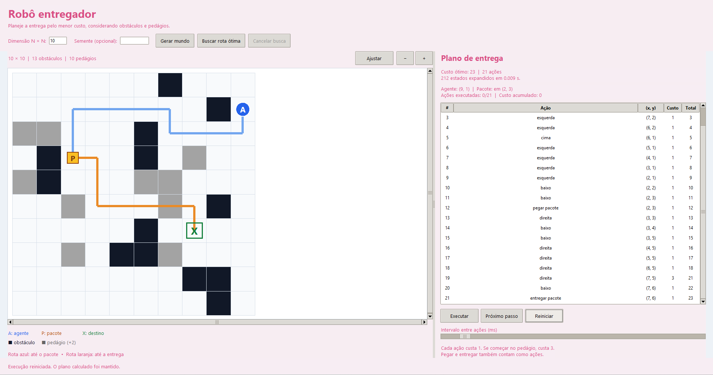
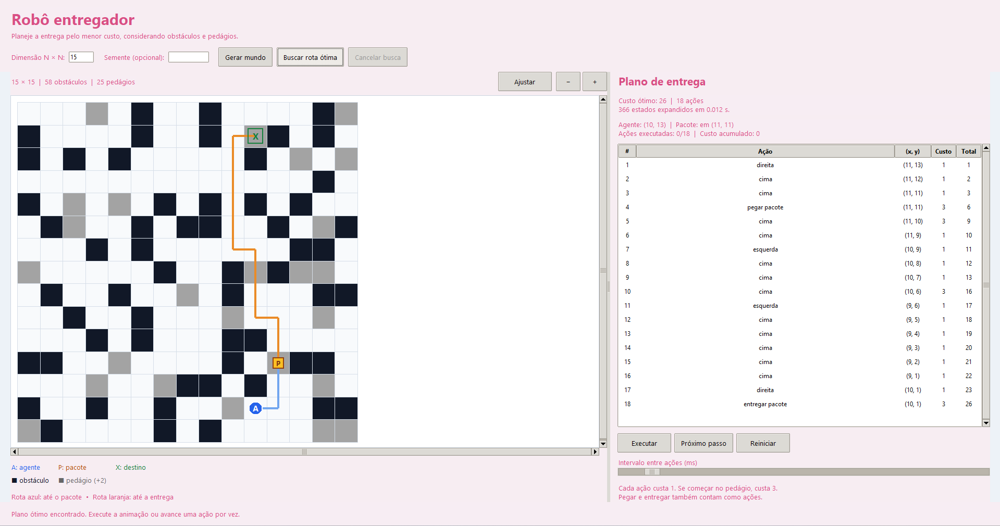
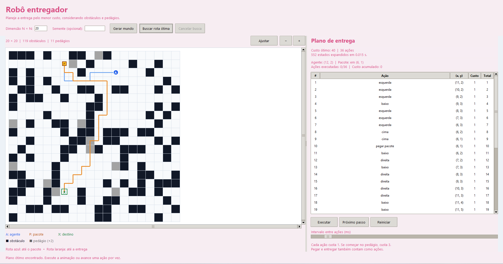

# Robô entregador em um mundo grid

Projeto da APS de Inteligência Artificial e Robótica que encontra um plano de menor custo para um agente buscar um pacote e entregá-lo em um grid quadrado com obstáculos e pedágios.

O usuário escolhe a dimensão do mundo pela interface gráfica. O programa sorteia o cenário, calcula a sequência de ações com a busca de custo uniforme da biblioteca `aigyminsper` e permite acompanhar a entrega por animação ou passo a passo. Quando os obstáculos impedem a entrega, a interface informa que não existe solução.

## Como executar

O projeto foi desenvolvido com Python 3.13. É necessário ter Python, Tkinter e a biblioteca `aigyminsper` disponíveis no ambiente.

Na pasta do projeto, instale a biblioteca:

```powershell
python -m pip install aigyminsper
```

Depois, abra a interface:

```powershell
python robo_entregador.py
```

O Tkinter acompanha a instalação padrão do Python para Windows. Para verificar se ele está disponível no seu ambiente, execute `python -m tkinter`.

## Como usar a interface

1. Informe um inteiro positivo no campo **Dimensão N × N**. Por exemplo, `10` cria um grid com 10 linhas e 10 colunas.
2. Se quiser repetir um cenário, preencha **Semente (opcional)** com um número inteiro. A mesma dimensão e semente reproduzem o mesmo mundo nesta implementação. Deixe o campo vazio para gerar novos cenários aleatórios.
3. Clique em **Gerar mundo** para sortear as posições.
4. Clique em **Buscar rota ótima**. O painel mostra o custo total, a quantidade de ações, os estados expandidos e o tempo da busca, ou a mensagem de que não existe solução.
5. Use **Executar** para iniciar a animação ou **Próximo passo** para executar uma ação por vez. Durante a animação, o botão **Executar** passa a permitir pausar.

O botão **Reiniciar** retorna ao estado inicial e mantém o plano calculado. O controle de intervalo ajusta o tempo entre as ações. Os botões **+**, **−**, **Ajustar** e as barras de rolagem permitem explorar o grid. **Cancelar busca** interrompe o planejamento; nesse caso, o programa não conclui se existe solução.

### Legenda do mundo

| Elemento | Significado |
| --- | --- |
| Círculo azul com `A` | Agente entregador |
| Caixa amarela com `P` | Pacote |
| Marcação verde com `X` | Destino da entrega |
| Célula preta | Obstáculo, onde o agente não pode entrar |
| Célula cinza | Pedágio, que acrescenta 2 ao custo de uma ação |
| Célula clara | Região livre, sem pedágio |
| Rota azul | Trajeto planejado até a coleta do pacote |
| Rota laranja | Trajeto planejado com o pacote até a entrega |

## Geração do cenário

A função `gerar_mundo` recebe a dimensão e uma semente opcional. Para grids de dimensão pelo menos 2, as posições iniciais do agente, do pacote e do destino são sorteadas em células distintas.

A quantidade de obstáculos também é sorteada: pode variar de zero até 35% das células, respeitando a reserva das três posições principais. Os pedágios são sorteados entre as células sem obstáculos e podem ocupar até 25% do grid. Agente, pacote e destino podem estar sobre pedágios.

A geração não força a existência de um caminho. Assim, obstáculos podem isolar o pacote ou o destino, produzindo um problema sem solução.

O código aceita qualquer dimensão inteira positiva, sem uma dimensão fixa no algoritmo. No caso **1×1**, agente, pacote e destino ocupam a única célula: o objetivo já está satisfeito e o custo ótimo é zero.

## Representação dos estados

As posições são tuplas `(x, y)`, com origem `(0, 0)` no canto superior esquerdo. `x` cresce para a direita e `y` cresce para baixo.

A classe `Estado` guarda os dados que mudam durante a execução:

```python
Estado(
    pos_atual=(0, 0),
    produto=(2, 1),
    carregando=False,
)
```

`pos_atual` representa a posição do agente e `produto` representa a posição do pacote. O atributo `carregando` distingue estar sobre o pacote de já tê-lo coletado. Enquanto o agente carrega o pacote, as duas posições se atualizam juntas. Os estados são imutáveis: cada ação produz um novo estado.

Os dados fixos ficam em `ProblemaEntrega`: dimensão, obstáculos, pedágios, destino e estado inicial. Obstáculos e pedágios são armazenados como conjuntos imutáveis (`frozenset`). O mapa é definido por essas informações, sem precisar guardar uma matriz de coordenadas.

## Ações e cálculo do custo

O agente pode executar seis ações:

| Ação | Efeito |
| --- | --- |
| `cima` | Diminui `y` em uma unidade |
| `baixo` | Aumenta `y` em uma unidade |
| `esquerda` | Diminui `x` em uma unidade |
| `direita` | Aumenta `x` em uma unidade |
| `pegar pacote` | Coleta o pacote quando agente e pacote estão na mesma célula |
| `entregar pacote` | Solta o pacote na célula atual, caso o agente o esteja carregando |

Um movimento contra um obstáculo ou para fora do grid mantém o agente no lugar. Pegar sem estar sobre o pacote e entregar sem carregá-lo também não alteram o estado. Essas ações continuam tendo custo, mas são omitidas da geração de sucessores porque não ajudam a encontrar um plano ótimo.

O custo depende da **célula onde a ação começa**:

```python
custo = 1 + (2 if estado.pos_atual in self.pedagios else 0)
```

Portanto, qualquer ação custa **1 em uma célula comum** e **3 em uma célula com pedágio**. Isso inclui pegar e entregar. Entrar em uma célula cinza a partir de uma célula comum custa 1; executar a próxima ação a partir dela custa 3.

O objetivo é alcançado quando o pacote está no destino **e o agente não está carregando o pacote**. Chegar ao destino carregando ainda exige executar a ação de entrega.

## Busca de custo uniforme com aigyminsper

A classe `EstadoEntrega` herda de `State`, da biblioteca, e adapta os estados da simulação ao algoritmo. Seus métodos principais são:

| Método | Responsabilidade |
| --- | --- |
| `successors()` | Cria os estados sucessores e associa a ação e seu custo a cada um |
| `is_goal()` | Verifica se o pacote foi entregue no destino |
| `cost()` | Informa o custo da ação que gerou o estado |
| `env()` | Identifica o estado para a poda de repetições |

A função `busca_custo_uniforme` prepara o estado inicial e chama a implementação da biblioteca:

```python
contexto = ContextoBusca(problema, cancelar)
inicial = EstadoEntrega(problema.estado_inicial, contexto)
algoritmo = BuscaCustoUniforme()
no_final = algoritmo.search(inicial, pruning="general")
```

A busca prioriza o menor custo acumulado. Por isso, o plano escolhido pode percorrer mais células para evitar pedágios: o objetivo é minimizar o custo total, incluindo coleta e entrega, e não apenas a quantidade de movimentos.

A biblioteca gerencia a fronteira, a poda e os nós `Node`. O custo acumulado é obtido em `no_final.g`. A sequência do plano é recuperada percorrendo os nós anteriores por `father_node`, reunindo ações, estados e custos para a interface.

### Poda e estados repetidos

O identificador retornado por `env()` inclui a posição do agente, a posição do pacote, o indicador de transporte e o custo da última ação. Esse último dado permite distinguir chegadas à mesma configuração que custaram 1 ou 3, preservando alternativas mais baratas na poda por inserção usada pela versão 0.3.5 da biblioteca. O custo acumulado e o histórico de ações não entram no identificador, permitindo eliminar ciclos.

Embora a simulação permita soltar o pacote em qualquer célula, a busca descarta entregas fora do destino. Essa poda preserva o plano ótimo: carregar o pacote não altera movimentos nem pedágios, portanto continuar carregando pelo mesmo trajeto evita o custo de soltar e coletar novamente.

### Quando não existe solução

Com a poda de repetições, a busca pode esgotar os estados alcançáveis. Se nenhum deles satisfizer o objetivo, a biblioteca retorna `None` e a interface exibe **“Não existe solução para este mundo”**.

Isso pode acontecer quando o agente não consegue alcançar o pacote ou quando, após a coleta, não consegue chegar ao destino. Uma busca cancelada é apresentada separadamente e não é tratada como ausência de solução.

## Organização do código

| Componente | Função |
| --- | --- |
| `Estado` | Guarda posição do agente, posição do pacote e situação de transporte |
| `ProblemaEntrega` | Valida o mundo, aplica as ações e gera sucessores da simulação |
| `gerar_mundo` | Sorteia as posições e quantidades dos elementos |
| `ContextoBusca` | Compartilha o problema, o cancelamento e a contagem de expansões |
| `EstadoEntrega` | Implementa o contrato de `State` da `aigyminsper` |
| `busca_custo_uniforme` | Chama a busca da biblioteca e organiza o plano retornado |
| `ResultadoBusca` | Reúne o resultado, o plano, os custos e as estatísticas |
| `InterfaceApp` | Controla a janela, o desenho do grid e a animação |

A geração e a busca executam em uma thread auxiliar. Uma fila leva os resultados à interface, que os recebe pelo agendamento `after` do Tkinter. A animação também usa `after`, permitindo atualizar a tela entre as ações. Para grids grandes, o desenho considera apenas a região visível e oferece rolagem.

## Imagens de exemplo

As capturas mostram planos calculados antes de iniciar a animação. A tabela à direita apresenta cada ação, a posição resultante, o custo individual e o total acumulado.

### Grid 10×10

Neste cenário, o plano possui **21 ações e custo ótimo 23**, com 13 obstáculos e 10 pedágios. A diferença entre o número de ações e o custo corresponde ao adicional de uma ação executada em pedágio.



### Grid 15×15

Neste cenário, o plano possui **18 ações e custo ótimo 26**, com 58 obstáculos e 25 pedágios. A tabela mostra que as ações de pegar e entregar o pacote custam 3, pois são executadas em células com pedágio.



### Grid 20×20

Neste cenário, o plano possui **36 ações e custo ótimo 40**, com 119 obstáculos e 11 pedágios. A interface apresenta a rota planejada em um mundo de dimensão maior usando as mesmas regras de busca.


